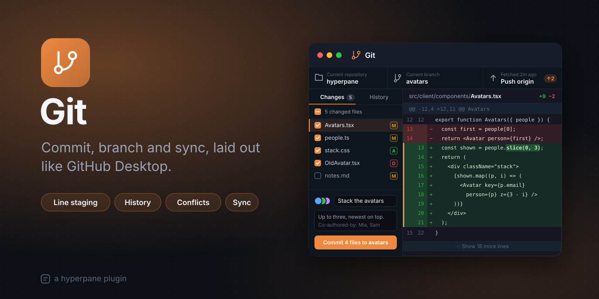

# Git

Commit, branch and sync, laid out like GitHub Desktop. Git puts a
project's repository in a window on your canvas: what changed, what you'll
commit, the history and its graph, branches and syncing, next to the code
you're working on. It runs your own `git`, so everything it does is what
git does, and your repository stays a plain repository.

## Features

- **Changes, as in GitHub Desktop:** every changed file is listed once and
  checked for the next commit as it comes. Uncheck a file, or a hunk or
  single lines in its diff (in the gutter), to leave them out. Git's index
  isn't touched until you commit, and then exactly what's checked goes in.
  Prefer staging by hand? Turn off **Check every change for the next
  commit** and stage files, hunks and lines yourself.
- **Discard safely:** discard a file, a hunk or lines; what you throw away
  goes to the Trash (the Recycle Bin on Windows) first. Ignore a file or a
  pattern from its right-click menu.
- **Commit** with a summary and description, amend the last commit, sign
  off, and add co-authors. It commits as the identity the repository's
  config says, and you can change it from the window.
- **Diffs:** unified or side by side, words that changed highlighted,
  whitespace ignored or not, more context on demand, images before and
  after, renames, and a summary for binary and huge files (with “show
  anyway”). Code you select with the mouse copies as text.
- **History** with a commit graph. Search by message, author, SHA, path or
  content (git's `-S` and `-G`). Each commit shows its message (fold it
  away for more room), its files and diffs, and its author with co-authors'
  avatars stacked. Check out, branch or tag from a commit, cherry-pick,
  revert or reset.
- **Branches**, local and remote, with ahead and behind counts: merge,
  rebase, compare. **Stashes** and **tags** each have their own tab.
- **A file's history and blame**, line by line.
- **Conflicts:** take ours, theirs, or choose block by block, then continue
  or abort the merge, rebase, cherry-pick or revert.
- **Sync:** fetch, pull, push, publish a branch, force with lease, with
  progress and cancel. Passwords and SSH passphrases are asked in a dialog.
  Fetch automatically every 5, 15 or 30 minutes if you like.
- **Clone** a repository, or **initialize** one in a folder that isn't yet.
- **In Explorer:** each file's status as a colored letter (U, A, M, D, R,
  !), a dot on folders with changes inside, ignored files faded, and
  **Stage with Git** in the right-click menu.

## How to use

1. Open it: right-click the canvas and choose **New Git**. It shows the
   repository of the project's folder; the repository button in the
   toolbar switches to another one or opens another folder.
2. A folder that isn't a repository yet offers **Initialize Repository**
   or **Clone…**, and lists the repositories it finds inside.
3. In **Changes**, check what goes in, write a summary, and press
   **Commit** (⌘↵, Ctrl+Enter on Windows and Linux).
4. Push, pull or fetch with the sync button at the right of the toolbar.

Keys: Ctrl+1 to Ctrl+5 switch between Changes, History, Branches, Stashes
and Tags; ⌘F (Ctrl+F) filters the list; ⌘[ and ⌘] (Ctrl+[ and Ctrl+]) go
back and forward, as do Alt+← and Alt+→ and the mouse's side buttons;
Escape closes a view opened over the tabs.

## Settings

| Setting | What it does | Default |
| --- | --- | --- |
| Git executable | The `git` to run. Empty: the one on `PATH`, else Git for Windows' or Homebrew's usual places. | empty |
| Default branch for new repositories | The first branch of a repository made with Initialize Repository. | `main` |
| Speed up history in big repositories | Writes git's commit-graph cache when a repository with a long history has none (as `git gc` does). | on |
| Fetch automatically | While a Git window shows a repository, fetch its remote every 5, 15 or 30 minutes. Remotes that ask for a password are skipped. | Never |
| Diff view | Unified or side by side at first; each window can switch. | Unified |
| Ignore whitespace | Leave whitespace changes out of diffs (lines can't be checked one by one then). | off |
| Context lines | Unchanged lines shown around each change (0 to 20). | 3 |
| Check every change for the next commit | GitHub Desktop's way (on), or stage by hand and commit what's staged (off). | on |
| Sign off commits | Add a `Signed-off-by` line to every commit, unless the commit box says otherwise. | off |

## Good to know

- It needs **git 2.23 or newer** on the computer the project runs on.
- What you check and uncheck in Changes belongs to the window and is kept
  on this machine; commits made elsewhere (a terminal, another tool) see
  only what you staged there, which Git leaves as it was.
- Line-by-line checking is off while **Ignore whitespace** is on.
- It's fast on big repositories. On a generated repository of 50,000
  commits and 10,000 files (an M4 Max): status in 126 ms, the first page of
  history in 35 ms (171 ms before git's commit-graph exists; the first
  watch writes it), and a 7.7 MB diff in 71 ms.

## How it works

The window is the client part; the work is done by a server part, a Node
process next to the project that runs the system's `git`. Status is one
`git status --porcelain=v2 -z`; history is read as git writes it and git
is stopped once a page is full; diffs are computed when asked and
cancelled when the selection moves, with caps on their size. A
repository's watch is shared by every window that shows it, and debounced.
A cancel kills git's whole process tree. Git's and SSH's prompts come to
the app through an askpass helper.

Every operation the server part offers (status, diffs, staging, commits,
history, blame, branches, stashes, tags, sync, Explorer's decorations), with
what it takes, what it returns and its errors, is in [API.md](API.md).
Other plugins can follow a repository on the event bus: Git publishes
`git.changed`, `git.committed` and `git.checkedOut`, and answers
`git.status` and `git.open`.

| Where | What it is |
| --- | --- |
| `src/server/` | The server part: `main.ts` serves it, `plugin.ts` wires each op to its handler, `ops/` has the ops by area, `lib/` finding, running and parsing git. |
| `src/shared/` | Reply and event types, and the patch builder for line and hunk staging. |
| `src/client/` | The window: `app/` (state, calls, layout, actions), `views/` (each tab, commits, conflicts, blame, dialogs), `components/` (the diff and shared pieces). |
| `test/` | Server tests on temporary repositories (and a bare remote over `file://` and HTTP), window tests with a fake app, and `bench.ts`. |

## Develop

    ./build.sh --test        # type-check, validate plugin.json, run the tests
    node --import ./node_modules/@hyperpane/sdk/register.mjs test/server/bench.ts /tmp/big   # the timings

Nothing is built: the app runs the TypeScript as it is.

## License

MIT, © 2026 Astralyx. See [LICENSE](LICENSE).
